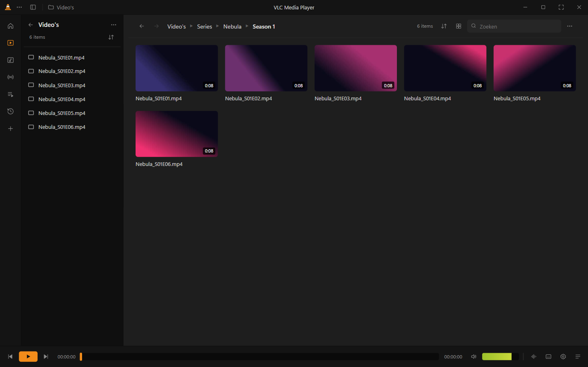
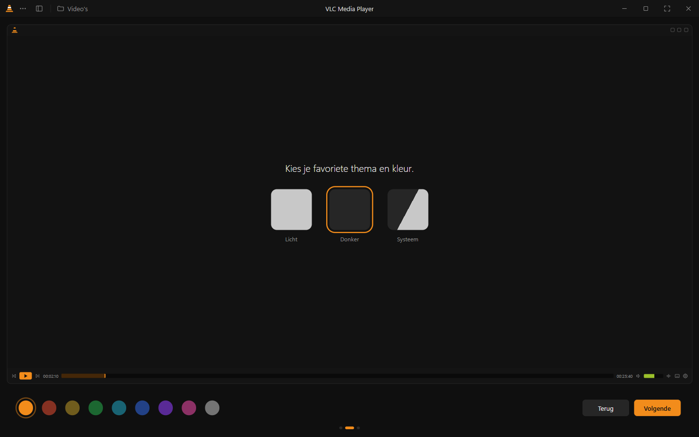
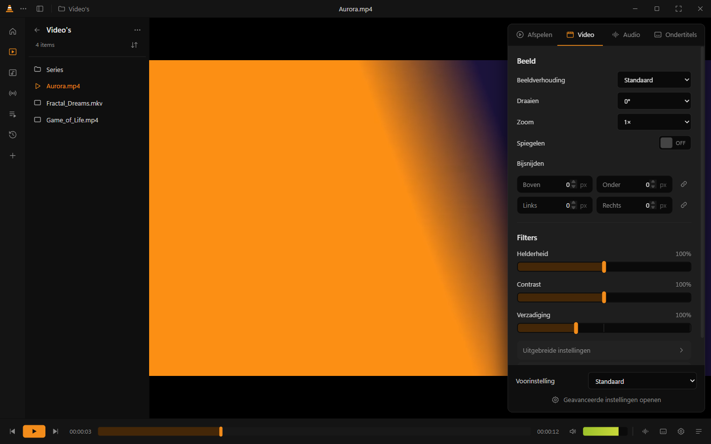
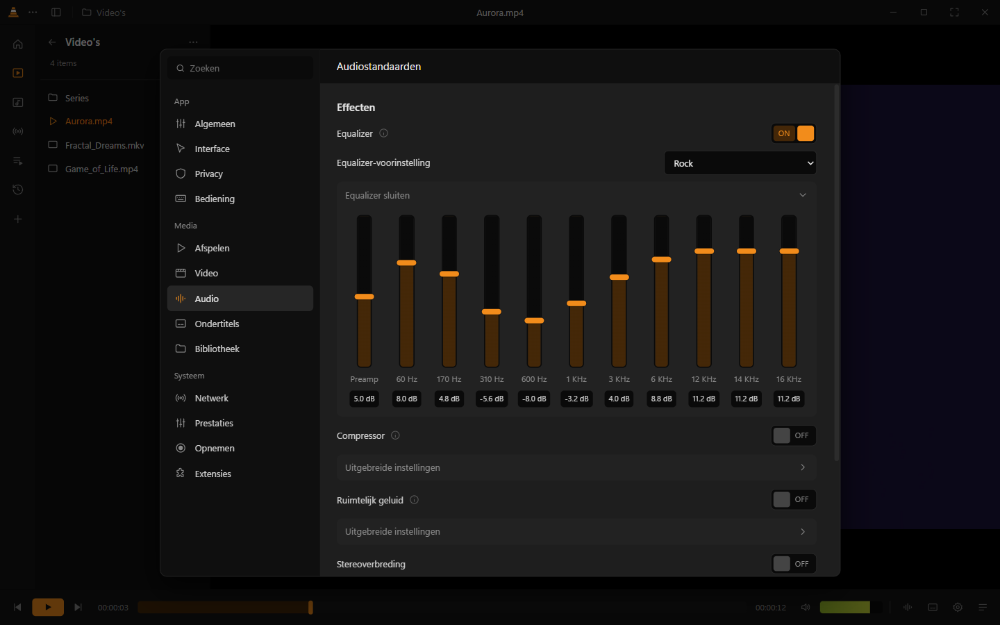
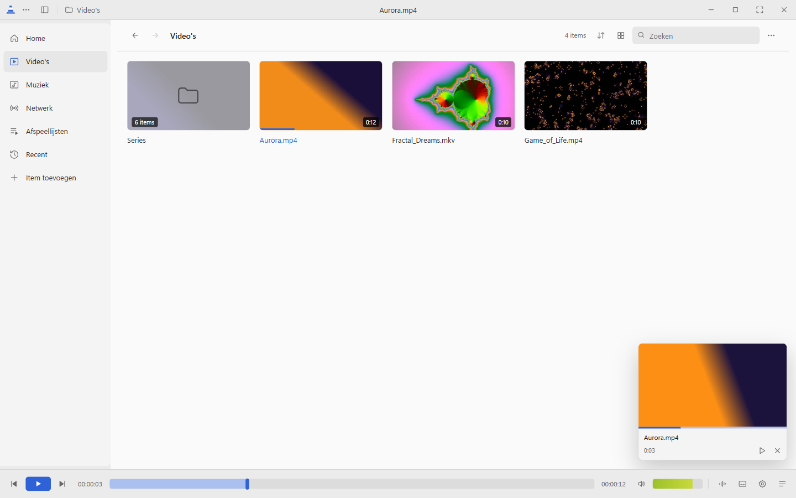

<div align="center">


# VLC Redesign

**An unofficial, modern desktop media player built from the VLC redesign by [Juxtopposed](https://www.youtube.com/@juxtopposed).**
For Windows, macOS and Linux · plays almost anything thanks to built-in FFmpeg.

[**⬇️ Download**](https://github.com/stanotermans/vlcmediaplayerv2/releases/latest) ·
[Download page](https://stanotermans.github.io/vlcmediaplayerv2/) ·
[Design video](https://www.youtube.com/watch?v=ERFeOgqk324)



</div>

> [!NOTE]
> This is an **unofficial fan project**. It is not made by, affiliated with, or endorsed by VideoLAN, the makers of the real VLC.
> "VLC" and the cone logo are trademarks of VideoLAN.

## 🎨 Design credits: Juxtopposed

The entire design of this app comes from **Juxtopposed**: the library, the player, the onboarding, the settings window, the menus and the audio/video panels.

- 📺 Video: **[I Redesigned VLC After 25 Years](https://www.youtube.com/watch?v=ERFeOgqk324)** by [Juxtopposed](https://www.youtube.com/@juxtopposed)
- 🎨 Figma: **[VLC Redesign (Community)](https://www.figma.com/design/7fsD7tE4rIOTEfaLAAQiDY/VLC-Redesign--Community-)**

This repository turns that design into a working app. All credit for the design goes to Juxtopposed. Go watch the video! 🙌

## ⬇️ Download

Open the **[latest release](https://github.com/stanotermans/vlcmediaplayerv2/releases/latest)** and pick the file for your system:

| Operating system | File |
|---|---|
| 🪟 **Windows 10 / 11** | `VLC-Redesign-Setup-<version>-x64.exe` (installer) or `VLC-Redesign-Portable-<version>.exe` |
| 🪟 Microsoft Store package | `VLC-Redesign-Store-<version>-x64.appx` |
| 🍎 **macOS** (Apple Silicon / Intel) | `VLC-Redesign-<version>-mac-arm64.dmg` / `…-mac-x64.dmg` |
| 🐧 **Debian, Ubuntu, Linux Mint, Chrome OS** | `vlc-redesign-<version>-amd64.deb` |
| 🐧 **Fedora, openSUSE, Red Hat** | `vlc-redesign-<version>-x86_64.rpm` |
| 🐧 **Arch Linux, Manjaro** | `vlc-redesign-<version>-x64.pacman` |
| 🐧 **Any Linux** (Gentoo, Slackware, …) | `vlc-redesign-<version>-x86_64.AppImage` or `.tar.gz` |

Or use the **[download page](https://stanotermans.github.io/vlcmediaplayerv2/)**, which detects your system automatically.

> 🌍 The app is available in **English, Dutch, German, French, Spanish, Italian and Portuguese**. You pick your language on first launch and can change it any time in Settings.

<details>
<summary><b>Installing on Linux</b></summary>

```bash
sudo apt install ./vlc-redesign-*-amd64.deb        # Debian, Ubuntu, Mint, Chrome OS
sudo dnf install ./vlc-redesign-*-x86_64.rpm       # Fedora, Red Hat
sudo zypper install ./vlc-redesign-*-x86_64.rpm    # openSUSE
sudo pacman -U ./vlc-redesign-*-x64.pacman         # Arch, Manjaro
chmod +x vlc-redesign-*.AppImage && ./vlc-redesign-*.AppImage   # any distribution
```

**Chrome OS:** turn on *Settings → About ChromeOS → Developers → Linux development environment*, then open the `.deb` file from the Files app.
</details>

<details>
<summary><b>First launch on Windows or macOS</b></summary>

The app is not code-signed (that requires a paid certificate), so your system shows a warning the first time:

- **Windows:** if the blue SmartScreen dialog appears, click *More info* → *Run anyway*. Windows releases are being set up for code signing via SignPath (see the [code signing policy](CODE_SIGNING.md)); even signed, a new release can trigger SmartScreen until it has built up reputation.
- **macOS:** right-click the app → *Open* → *Open*. Or in Terminal:
  ```bash
  xattr -dr com.apple.quarantine "/Applications/VLC Redesign.app"
  ```
</details>

## ✨ Features

- **Plays almost anything.** MP4, MKV, AVI, MOV, WMV, FLV, WebM, MP3, FLAC, AC3/DTS and more. Anything Chromium can't play natively is converted on the fly by the built-in FFmpeg.
- **Built-in updates.** The app checks GitHub for new releases and shows a notification. On Windows (installer) and Linux (AppImage) it downloads and installs the update itself; elsewhere it fetches the right file for you. You can also check manually under *Settings → ⓘ About*, which also shows the version, credits and licenses.
- **Instant seek preview.** Hover the timeline to see a thumbnail; a storyboard of frames is generated in the background so the preview follows your mouse without delay.
- **7 languages:** English, Nederlands, Deutsch, Français, Español, Italiano and Português, switchable instantly without restarting.
- **Onboarding** on first launch: choose your language, pick a media folder, choose a theme and accent color (with live preview), and learn the key shortcuts.
- **Library** with videos, music, network streams, playlists and recently played. Browse folders with breadcrumbs (Videos ▸ Shows ▸ The Wand ▸ S01), "continue watching", and watched items dimmed.
- **Playlists:** import `.m3u`, `.m3u8`, `.xspf` and `.pls` files (open, drag or *Playlists → Import playlist…*), an *All media* playlist with everything, and a list view with title, artist/album and duration columns you can sort by.
- **Player** with a timeline preview (hover the seek bar to see that moment), mini player, queue, resume where you left off, repeat/shuffle, playback speed, picture-in-picture, fullscreen and hide-UI mode.
- **Made for watching:** while a video plays, the sidebar tucks away so the video gets the full width, and the window resizes to the video's shape (up to 70% of the screen, like VLC). Both can be turned off in *Settings → Interface*. There you can also hide individual player controls (e.g. keep only the timeline) and turn on rounded window corners.
- **Subtitles:** embedded and external `.srt`/`.ass`/`.vtt` files load automatically. You can set the delay, speed, duration, font, color, outline and background.
- **Subtitle fonts:** pick any font installed on your computer, or add your own `.ttf`/`.otf`/`.woff` files in *Settings → Subtitles*.
- **Online subtitles:** search and download subtitles from [OpenSubtitles.com](https://www.opensubtitles.com) without leaving the player (right-click → *Subtitle → Search online…*). Results that fit your exact file are marked; an optional free account raises the daily limit from 5 to 20.
- **Music with lyrics:** album covers in the player and as square tiles in the library. A `.lrc` file next to a song is loaded automatically and shown full-screen, scrolling along with the song (click a line to jump there); for videos `.lrc` files work as subtitles. The music player background can be a blurred cover, a gradient from the cover's colors or black, with adjustable dimming and cover size; press Y to switch between cover and lyrics.
- **Audio:** multiple audio tracks, a 10-band equalizer with 18 presets, compressor, spatial audio (reverb), stereo widener and volume boost up to 200%.
- **Video:** brightness, contrast, saturation, hue, gamma, sharpen, film grain, negative, posterize, grayscale, sepia, pixel cropping, rotate, zoom and mirror.
- **Themes:** light, dark, AMOLED black or system, with 9 accent colors, and an interface size from 75% to 150% (*Settings → General*, or Ctrl + / Ctrl − / Ctrl 0).
- **Recording** (R) and **snapshots** (Shift+S).
- **Settings:** right-click menu with submenus, quick settings in the player, and a full settings window with search (Ctrl+P).

<details>
<summary><b>Keyboard shortcuts</b></summary>

| Key | Action | Key | Action |
|---|---|---|---|
| `Space` | Play / pause | `F` | Fullscreen |
| `←` `→` | Seek | `↑` `↓` | Volume |
| `<` `>` / `P` `N` | Previous / next | `Q` | Queue |
| `,` `.` | Previous / next frame | `L` | Library / player |
| `V` | Cycle subtitle track | `B` | Cycle audio track |
| `Shift+S` | Snapshot | `R` | Record |
| `S` | Stop | `M` | Mute |
| `[` `]` `=` | Slower / faster / normal | `G` `H` | Subtitle delay |
| `Ctrl+O` | Open files | `Ctrl+N` | Network stream |
| `Ctrl+P` | Settings | `Ctrl+\` | Hide interface |
| `F1` | All shortcuts | `Ctrl+Q` | Quit |
</details>

## 🖼️ Screenshots

| Onboarding | Player with quick settings |
|---|---|
|  |  |
| **Settings** | **Light mode** |
|  |  |

## 🛠️ Building from source

Requires [Node.js](https://nodejs.org) 20 or newer.

```bash
cd app
npm install
npm start               # run the development version
npm run dist:win        # Windows: installer + portable (on Windows)
npm run dist:store      # Microsoft Store package (on Windows)
npm run dist:mac        # macOS (on a Mac)
npm run dist:linux      # Linux: AppImage, deb, rpm, pacman, tar.gz (on Linux)
```

### Slim FFmpeg

Like VLC, the release builds don't ship a general-purpose FFmpeg. [`app/build/ffmpeg/build.sh`](app/build/ffmpeg/build.sh) compiles FFmpeg from source with `--disable-everything`, then switches on all decoders, demuxers and parsers (so it still plays almost anything) but only the few encoders, muxers and filters the app uses (H.264/AAC for live conversion, JPEG thumbnails, WebVTT subtitles). That brings the FFmpeg binary from ±80 MB down to a fraction of that. The release workflow builds it automatically; to build it yourself:

```bash
bash app/build/ffmpeg/docker.sh win-x64      # or linux-x64 (needs Docker)
bash app/build/ffmpeg/build.sh mac-arm64     # or mac-x64 (on a Mac, with nasm + pkg-config)
```

The result lands in `app/build/ffmpeg/out/<target>/`. Copy it over `app/node_modules/ffmpeg-static/ffmpeg[.exe]` before running `electron-builder`. During development the full `ffmpeg-static` binary is used.

### Making a release

The workflow [`.github/workflows/build.yml`](.github/workflows/build.yml) builds the app on GitHub's servers for Windows, macOS and Linux, and creates a release with a download table automatically:

```bash
# first set the version in app/package.json, e.g. "version": "1.10.0"
git tag v1.10.0
git push origin v1.10.0
```

You can also run the workflow manually (*Actions → Build & Release → Run workflow*). The files then appear under *Artifacts*.

### Download page (GitHub Pages)

The page in [`docs/`](docs/index.html) is published at `https://stanotermans.github.io/vlcmediaplayerv2/`. To enable it, go to *Settings → Pages → Deploy from a branch → `main` / `/docs`*. It always shows the latest release.

### BSD

Electron has no official builds for BSD. On FreeBSD (and OpenBSD) you can run the app with the system's Electron port; it then uses the system's FFmpeg:

```sh
pkg install electron36 ffmpeg node npm      # the port's version number may differ: pkg search electron
cd app && npm install --ignore-scripts --omit=dev
electron36 .
```

To use your own FFmpeg, set `VLCX_FFMPEG=/path/to/ffmpeg`.

### Project structure

```
app/
  main.js          Electron main process: window, local media server, FFmpeg transcoding, file dialogs
  preload.js       Secure bridge between the main process and the UI
  src/
    index.html     UI layout
    style.css      Design (light/dark, accent color)
    settings.js    Preferences and theme
    ui.js          Building blocks: sliders, toggles, menus, dialogs
    effects.js     Audio effects (Web Audio) and video filters
    panels.js      Quick settings, settings window and dialogs
    onboarding.js  Welcome screen (language, media folder, theme, shortcuts)
    i18n.js        Translation system
    lang/*.js      Translations (nl, de, fr, es, it, pt; English is built in)
    app.js         Library, player, subtitles, keyboard shortcuts
  build/icon.png   App icon (generated by build/make-icon.js)
  build/ffmpeg/    Recipe for the slim FFmpeg used in releases
docs/              Download page for GitHub Pages
```

## ❓ Why not iOS, Android, …?

The app runs on [Electron](https://www.electronjs.org), which only supports Windows, macOS and Linux. **iOS, Apple TV and Android** would need a separate native app. **Windows Phone** has been discontinued, and **NetBSD, Solaris, QNX and OS/2** have no Electron or Chromium.

## 🤝 Community

- [Contributing guide](CONTRIBUTING.md): bug reports, ideas, translations and code
- [Code of Conduct](CODE_OF_CONDUCT.md)
- [Security policy](SECURITY.md): report vulnerabilities privately
- [Code signing policy](CODE_SIGNING.md): free code signing provided by [SignPath.io](https://about.signpath.io), certificate by [SignPath Foundation](https://signpath.org)
- [Accessibility](ACCESSIBILITY.md): what's supported, known limitations and how to report barriers

## 📄 License

- **Code:** [MIT](LICENSE) © Stan Otermans
- **Design:** © [Juxtopposed](https://www.youtube.com/@juxtopposed), used with attribution based on the publicly shared Figma community file.
- Includes [FFmpeg](https://ffmpeg.org) with [x264](https://www.videolan.org/developers/x264.html), licensed under the GPL. Release builds use the slim build from [`app/build/ffmpeg/build.sh`](app/build/ffmpeg/build.sh) (source: the FFmpeg and x264 versions pinned there); development uses [ffmpeg-static](https://github.com/eugeneware/ffmpeg-static).
- "VLC" and the cone logo are trademarks of [VideoLAN](https://www.videolan.org). This project is not affiliated with VideoLAN.
